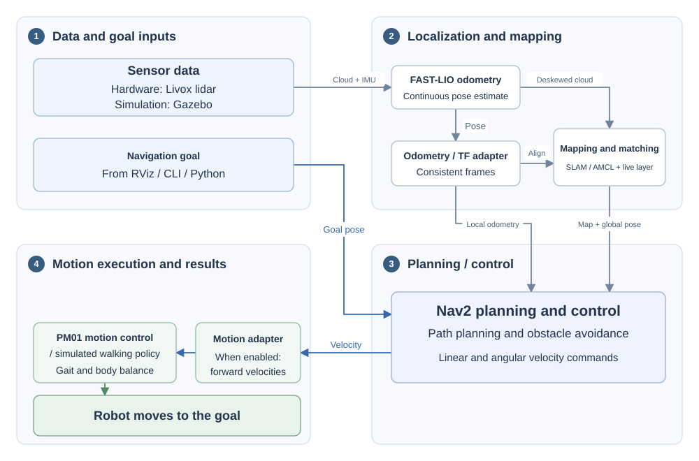
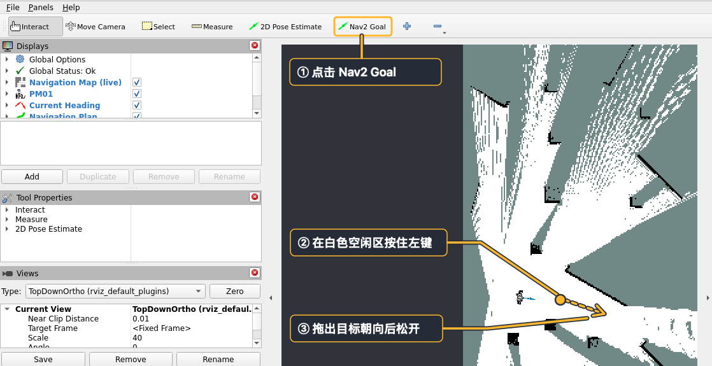

# FAST-LIO Navigation for PM01

[简体中文](README.md) | English

A PM01 navigation reference project based on **FAST-LIO and Nav2**, with Gazebo simulation, hardware deployment, an optional navigation console, and standard ROS 2 / Python interfaces. It supports indoor mapping on level ground, live obstacle updates, and point-to-point navigation development.

[Quick start](#quick-start) · [Repository structure](#repository-structure) · [Documentation](#documentation)

## Features and architecture

- **Mapping and navigation:** 2D SLAM with loop closure for new maps; continuous AMCL localization on saved maps after providing an initial pose.
- **Live obstacle updates:** mark obstacles from lidar observations and clear areas observed to be free.
- **Navigation console:** start navigation, manage maps, inspect status, cancel goals, and enable or release motion output.
- **Standard interfaces:** Nav2 actions, ROS 2 topics and services, and Python application interfaces.
- **Modular design:** separate adapters for sensors, odometry, mapping, planning and control, and motion protocols.



FAST-LIO provides continuous local motion estimates. SLAM Toolbox handles new-map matching and loop closure, while AMCL localizes on saved maps. Nav2 plans paths and generates velocities from the map and pose; PM01 motion control executes them.

The unified launch entry starts the required perception, localization, and mapping modules. Simulation opens RViz automatically; for hardware, RViz runs on the development computer. The console is optional, and motion output is disabled by default in every mode.

## Repository structure

Functional packages correspond to the four sections in the architecture diagram. Platform adapters and application tools are listed separately. Each package's README and `package.xml` describe its responsibilities and dependencies.

```text
engineai_fastlio_navigation/
├── src/                                # ROS 2 packages and vendored sources
│   │   # 1. Data and goal inputs: sensor data ingestion
│   ├── livox_ros_driver2/              # Livox lidar driver
│   ├── pm01_navigation_perception/     # Deskewed cloud adaptation and 2D scans
│   │
│   │   # 2. Localization and environment modeling
│   ├── FAST_LIO_ROS2/                  # FAST-LIO local odometry
│   ├── slam_toolbox/                   # 2D matching, loop closure, pose graph; project adaptations
│   ├── pm01_navigation_core/           # Ground filtering, live map, SLAM/AMCL integration
│   │
│   │   # 3. Navigation planning and control
│   ├── pm01_navigation_nav2/           # Nav2 controllers, goal checking, trajectory critics
│   │
│   │   # 4. Motion execution and results: output management
│   ├── pm01_navigation_motion/         # Enable/release output and manage bridge processes
│   │
│   │   # Platform adapters: localization and motion output
│   ├── pm01_navigation_hardware/       # Velocity protocol and LIO-to-base odometry/TF conversion
│   ├── pm01_navigation_sim/            # Velocity adaptation, dynamic TF, startup support
│   ├── interface_protocol/             # PM01 motion-control messages
│   ├── engineai_navigation/            # Vendored Gazebo simulator and walking-policy sources
│   │
│   │   # Applications and infrastructure
│   ├── pm01_navigation_client/         # Python API, CLI, examples
│   ├── pm01_navigation_console/        # Optional operator interface
│   ├── pm01_navigation_bringup/        # Launch composition and worlds; defaults in root config/
│   └── pm01_navigation_runtime/        # Configuration, sessions, builds, deployment
├── config/                             # Adjustable default configuration
│   ├── hardware/                       # Hardware sensors, navigation, RViz
│   ├── sim/                            # Simulation gait, navigation, RViz
│   ├── matching/                       # Scans, SLAM, AMCL
│   ├── console/                        # Console example
│   ├── automatic_ground.yaml           # Shared ground estimation
│   └── pm01_lidar_tf.yaml               # Lidar mounting extrinsics
├── scripts/                            # Installation, build, deployment, release entry points
├── docker/
│   └── hardware/                       # ARM64 image and container entry point
├── docs/                               # Tutorials, configuration, and interfaces
│   ├── tutorial.md                     # Complete simulation and hardware workflows
│   ├── tutorial.en.md                  # Complete English tutorial
│   ├── images/                         # Tutorial screenshots and diagrams
│   └── ...
├── tests/                              # Test entry point and cross-package checks
│   ├── run.py                          # Unified test command
│   ├── pytest.ini                      # Test configuration
│   ├── contracts/                      # Package boundaries and public interfaces
│   └── integration/                    # Modes, TF, map consistency
├── dependencies.repos                  # Pinned external resources and SDKs
├── THIRD_PARTY.md                      # Third-party origins and licenses
└── LICENSE                             # Project license
```

## Quick start

Run simulation on an Ubuntu 22.04 x86_64 desktop with ROS 2 Humble. Working OpenGL is required; an NVIDIA GPU is recommended.

### 1. Clone and build

```bash
cd ~
git clone https://github.com/engineai-robotics/engineai_tutorials.git
cd engineai_tutorials/engineai_fastlio_navigation
bash scripts/install_dependencies.sh sim
bash scripts/build.sh sim
```

The installation script prepares ROS 2, Nav2, Gazebo, and RViz. The build script downloads pinned meshes, walking models, MNN, and the lidar SDK.

### 2. Start simulation

```bash
source scripts/env.sh
ros2 launch pm01_navigation_bringup navigation.launch.py profile:=sim mode:=fresh
```

Gazebo and RViz open automatically. Wait for the robot to stand steadily and for the map and robot pose to appear in RViz.

### 3. Start navigation

Enable motion output in another terminal.

```bash
cd ~/engineai_tutorials/engineai_fastlio_navigation
source scripts/env.sh
ros2 run pm01_navigation_client pm01_nav enable-motion
```

Motion output is disabled by default. Once enabled, select **Nav2 Goal** at the top of RViz. Hold the left mouse button in white free space, drag to the desired heading, and release.



### 4. Save the map and finish

Save the map and release motion output from the client terminal.

```bash
ros2 run pm01_navigation_client pm01_nav save-map
ros2 run pm01_navigation_client pm01_nav release-motion
ros2 run pm01_navigation_client pm01_nav status
```

After `save-map` returns `success=True`, record the map path. Confirm `output_process_running: false`, `output_publishers: 0`, and `output_detached: true`, then press `Ctrl-C` in the simulation launch terminal.

## Documentation

| Topic | Where to start |
| --- | --- |
| Full tutorial | [Simulation](docs/tutorial.en.md#simulation), [Hardware](docs/tutorial.en.md#hardware) |
| Configuration | [Defaults and overrides](docs/development.en.md#configuration-overrides) |
| Application interfaces | [ROS 2 interfaces](docs/development.en.md#application-interfaces), [Python examples](src/pm01_navigation_client/examples/README.en.md) |
| How it works | [PM01 navigation principles (Feishu, Chinese)](https://dx3a2bminsq.feishu.cn/wiki/EQIzwTD5Hibfl5kNQW5cmdcDnIb?from=from_copylink) |

Release package [v1.0.0](https://github.com/engineai-robotics/engineai_tutorials/releases/tag/pm01-navigation-v1.0.0).

## License

Shenzhen Zhongqing Robot Technology Co., Ltd. ("EngineAI") owns the copyright to the project code.

Project-owned code uses Apache-2.0. Third-party components retain their original licenses. See [third-party notices](THIRD_PARTY.en.md) for the sources and licenses of FAST-LIO, SLAM Toolbox, drivers, and models, and [LICENSE](LICENSE) for the project license.
