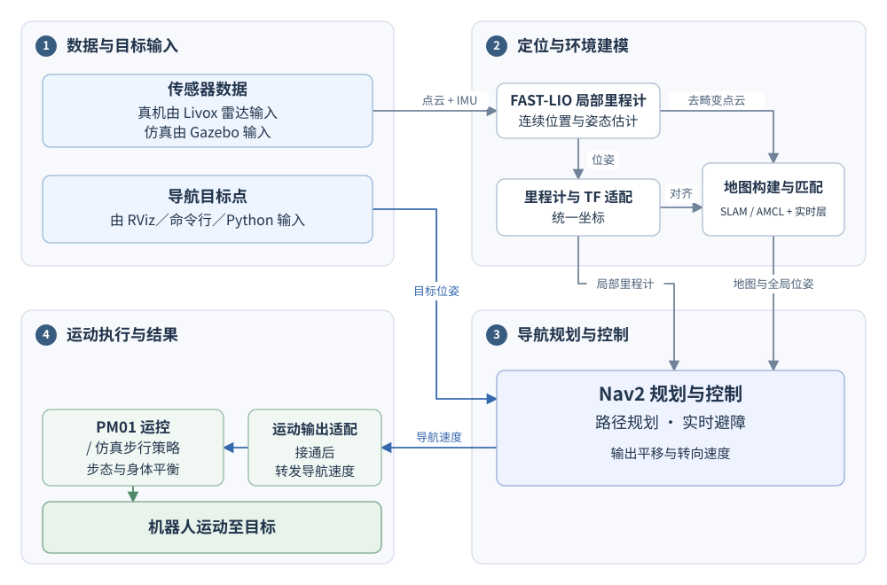
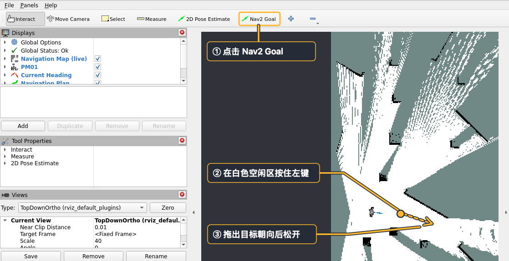

# FAST-LIO Navigation for PM01

简体中文 | [English](README.en.md)

基于 **FAST-LIO 和 Nav2** 的 PM01 导航参考工程，提供 Gazebo 仿真、真机部署、导航控制台及标准 ROS 2 / Python 接口，适用于室内平地建图、实时障碍更新和到点导航开发。

[快速启动](#快速启动) · [仓库结构](#仓库结构) · [文档](#文档)

## 功能与架构

- **建图与导航**：新图支持二维 SLAM 回环优化；加载二维旧图后给出初始位置，由 AMCL 持续匹配定位。
- **实时障碍更新**：根据雷达观测标记障碍，并清除已观测为空闲的区域。
- **导航控制台**：启动导航、管理地图、查看状态、取消目标和接通／释放运动输出。
- **标准接口**：使用 Nav2 Action、ROS 2 话题与服务，支持 Python 上层应用。
- **模块化设计**：传感器、里程计、地图、规划控制与运控协议分别适配。



FAST-LIO 提供连续局部运动估计，SLAM Toolbox 负责新图匹配与回环，AMCL 负责旧图定位；Nav2 根据地图和位姿规划路径、生成速度，由 PM01 运控执行。

统一入口自动启动所需的感知、定位和地图模块。仿真自动打开 RViz，真机 RViz 在开发电脑运行。控制台可选，各模式的运动输出均默认关闭。

## 仓库结构

功能包对应上方架构图的四个板块，平台适配和应用工具单列。包内职责与依赖见各包的 README 和 `package.xml`。

```text
engineai_fastlio_navigation/
├── src/                                # ROS 2 包与第三方源码
│   │   # ① 数据与目标输入：传感数据接入
│   ├── livox_ros_driver2/              # Livox 雷达驱动
│   ├── pm01_navigation_perception/     # 去畸变点云适配与二维扫描
│   │
│   │   # ② 定位与环境建模
│   ├── FAST_LIO_ROS2/                  # FAST-LIO 局部里程计
│   ├── slam_toolbox/                   # 二维匹配、回环与位姿图（含项目修改）
│   ├── pm01_navigation_core/           # 地面过滤、实时地图与 SLAM／AMCL 接入
│   │
│   │   # ③ 导航规划与控制
│   ├── pm01_navigation_nav2/           # Nav2 控制器、到点检查与轨迹评价插件
│   │
│   │   # ④ 运动执行与结果：输出管理
│   ├── pm01_navigation_motion/         # 输出接通、释放与桥接进程管理
│   │
│   │   # 平台适配：跨定位与运动输出
│   ├── pm01_navigation_hardware/       # 速度协议转换、LIO 到底座的里程计与 TF 转换
│   ├── pm01_navigation_sim/            # 速度适配、动态 TF与启动辅助
│   ├── interface_protocol/             # PM01 运控消息
│   ├── engineai_navigation/            # 内置 Gazebo 模拟器与步行策略源码
│   │
│   │   # 应用工具与工程支撑
│   ├── pm01_navigation_client/         # Python 接口、命令行与示例
│   ├── pm01_navigation_console/        # 可选操作界面
│   ├── pm01_navigation_bringup/        # 启动组合与场景；配置见根目录 config
│   └── pm01_navigation_runtime/        # 配置、会话、构建与部署
├── config/                             # 用户可调的默认配置
│   ├── hardware/                       # 真机传感器、导航与 RViz
│   ├── sim/                            # 仿真步态、导航与 RViz
│   ├── matching/                       # 扫描、SLAM 与 AMCL
│   ├── console/                        # 控制台示例
│   ├── automatic_ground.yaml           # 共享地面估计
│   └── pm01_lidar_tf.yaml               # 雷达安装外参
├── scripts/                            # 安装、构建、部署与发布入口
├── docker/
│   └── hardware/                       # ARM64 镜像与容器入口
├── docs/                               # 实操教程、配置与接口
│   ├── tutorial.md                     # 仿真与真机完整操作流程
│   ├── tutorial.en.md                  # 完整英文教程
│   ├── images/                         # 教程截图与流程图
│   └── ···
├── tests/                              # 测试入口与跨包验证
│   ├── run.py                          # 统一测试命令
│   ├── pytest.ini                      # 测试配置
│   ├── contracts/                      # 包边界与公共接口
│   └── integration/                    # 导航模式、TF 与地图一致性
├── dependencies.repos                  # 外部资源与 SDK 版本清单
├── THIRD_PARTY.md                      # 第三方来源与许可
└── LICENSE                             # 项目许可证
```

## 快速启动

在 Ubuntu 22.04 x86_64 桌面环境中运行仿真，使用 ROS 2 Humble。需要可用的 OpenGL，推荐 NVIDIA GPU。

### 1. 克隆与构建

```bash
cd ~
git clone https://github.com/engineai-robotics/engineai_tutorials.git
cd engineai_tutorials/engineai_fastlio_navigation
bash scripts/install_dependencies.sh sim
bash scripts/build.sh sim
```

安装脚本会准备 ROS 2、Nav2、Gazebo 和 RViz，构建脚本会获取固定版本的网格、步行模型、MNN 和雷达 SDK。

### 2. 启动仿真

```bash
source scripts/env.sh
ros2 launch pm01_navigation_bringup navigation.launch.py profile:=sim mode:=fresh
```

Gazebo 和 RViz 自动打开。等待机器人站稳，并在 RViz 中看到地图与机器人位置。

### 3. 开始导航

在另一个终端接通运动输出。

```bash
cd ~/engineai_tutorials/engineai_fastlio_navigation
source scripts/env.sh
ros2 run pm01_navigation_client pm01_nav enable-motion
```

运动输出默认关闭。接通后，在 RViz 顶部选择 **Nav2 Goal**，在白色空闲区按住鼠标左键，拖出目标朝向后松开。



### 4. 保存地图与结束

在客户端终端执行下面的命令，保存地图并释放运动输出。

```bash
ros2 run pm01_navigation_client pm01_nav save-map
ros2 run pm01_navigation_client pm01_nav release-motion
ros2 run pm01_navigation_client pm01_nav status
```

存图返回 `success=True` 后记录地图路径。确认状态中 `output_process_running: false`、`output_publishers: 0` 和 `output_detached: true`，再在仿真启动终端按 `Ctrl-C` 结束会话。

## 文档

| 内容 | 入口 |
|---|---|
| 完整实操 | [仿真教程](docs/tutorial.md#仿真)、[真机教程](docs/tutorial.md#真机) |
| 配置 | [默认参数与覆盖方式](docs/development.md#配置覆盖) |
| 应用接口 | [ROS 2 接口](docs/development.md#应用接口)、[Python 示例](src/pm01_navigation_client/examples) |
| 原理篇 | [PM01 导航原理（飞书）](https://dx3a2bminsq.feishu.cn/wiki/EQIzwTD5Hibfl5kNQW5cmdcDnIb?from=from_copylink) |

发布入口：[v1.0.0](https://github.com/engineai-robotics/engineai_tutorials/releases/tag/pm01-navigation-v1.0.0)。

## 许可证

项目自有代码版权归 Shenzhen Zhongqing Robot Technology Co., Ltd. ("EngineAI") 所有。

项目自有代码采用 Apache-2.0，各第三方组件保留其原有许可证。FAST-LIO、SLAM Toolbox、驱动与模型的来源及许可见[第三方声明](THIRD_PARTY.md)，项目许可见 [LICENSE](LICENSE)。
