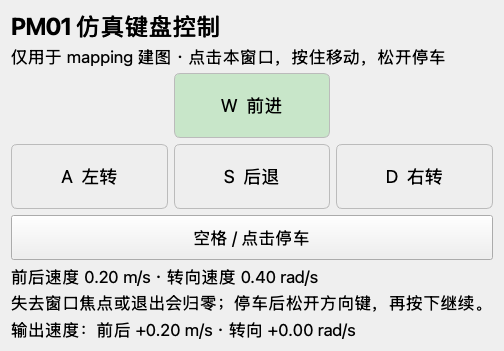
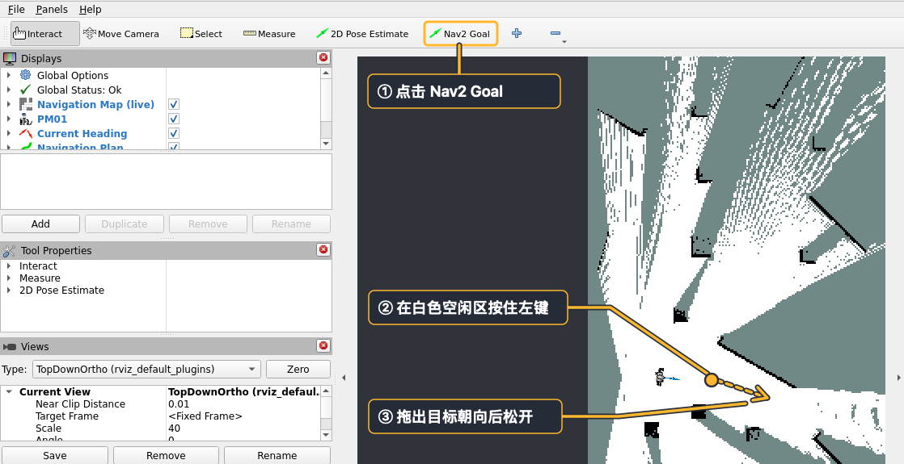
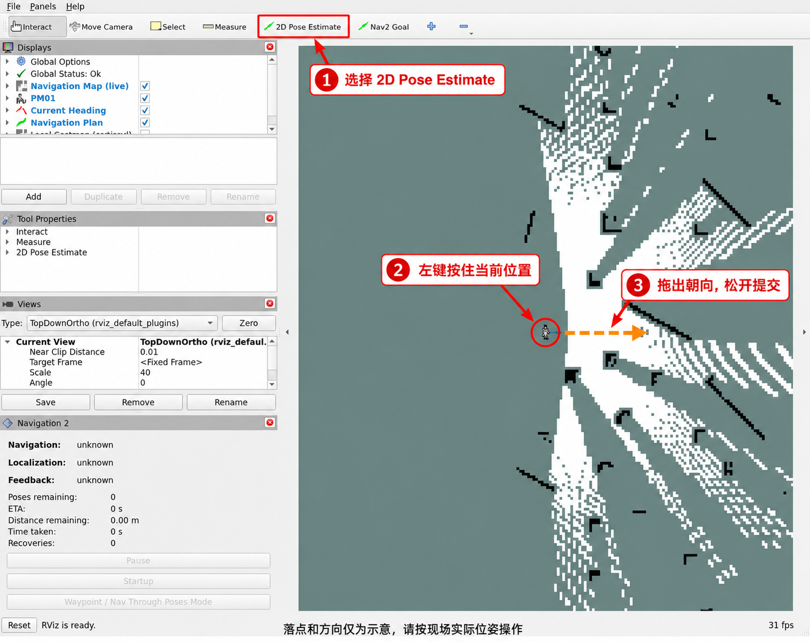
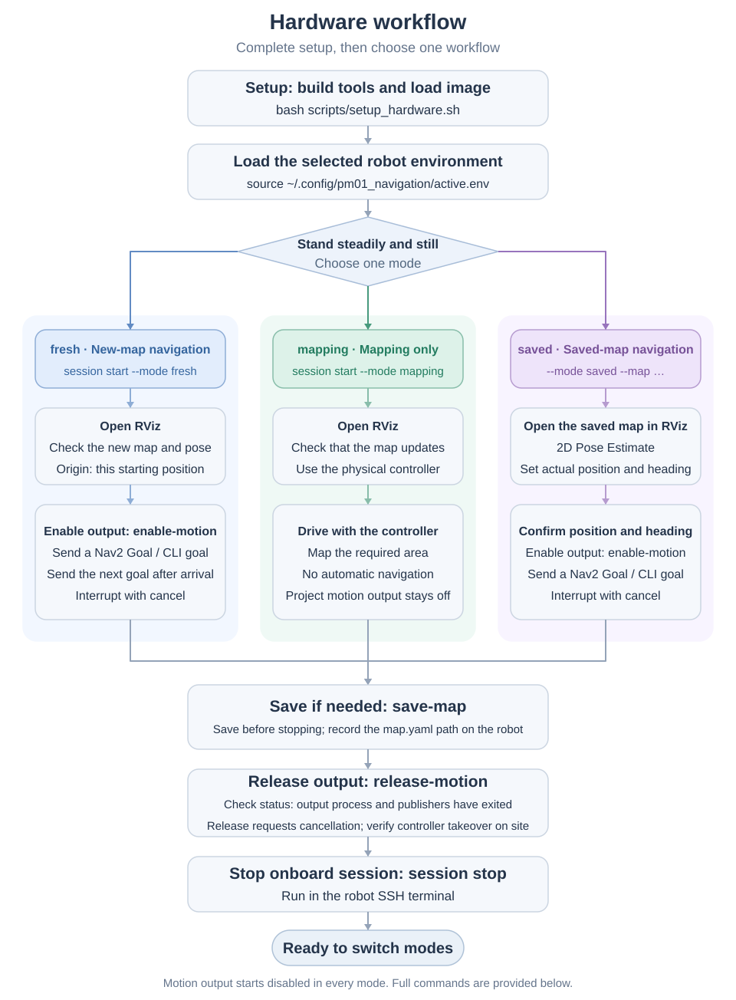
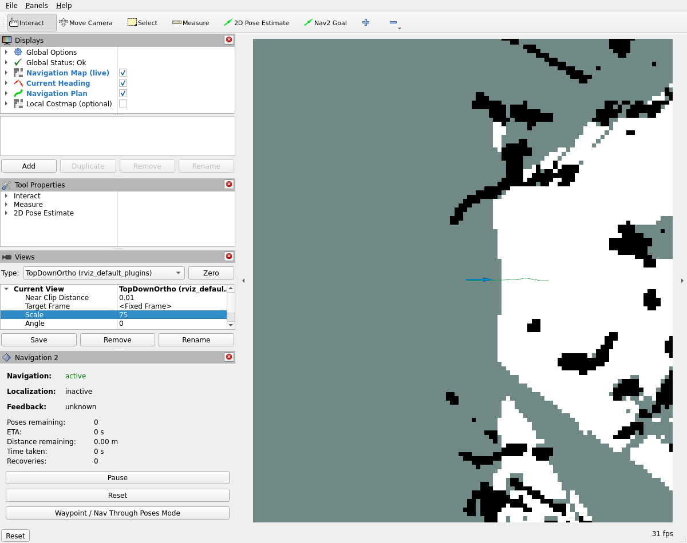
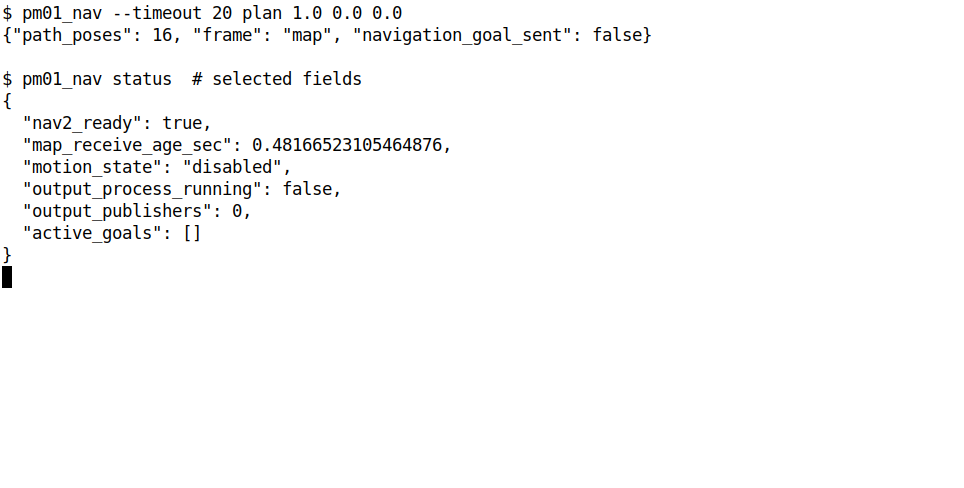
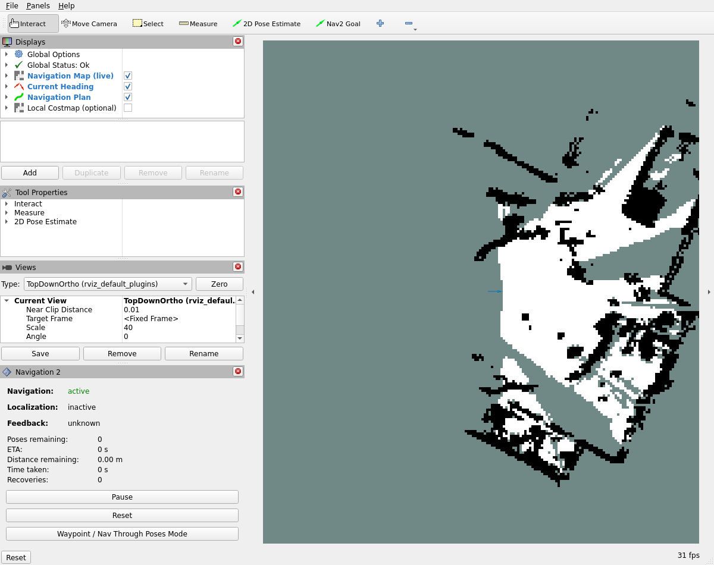
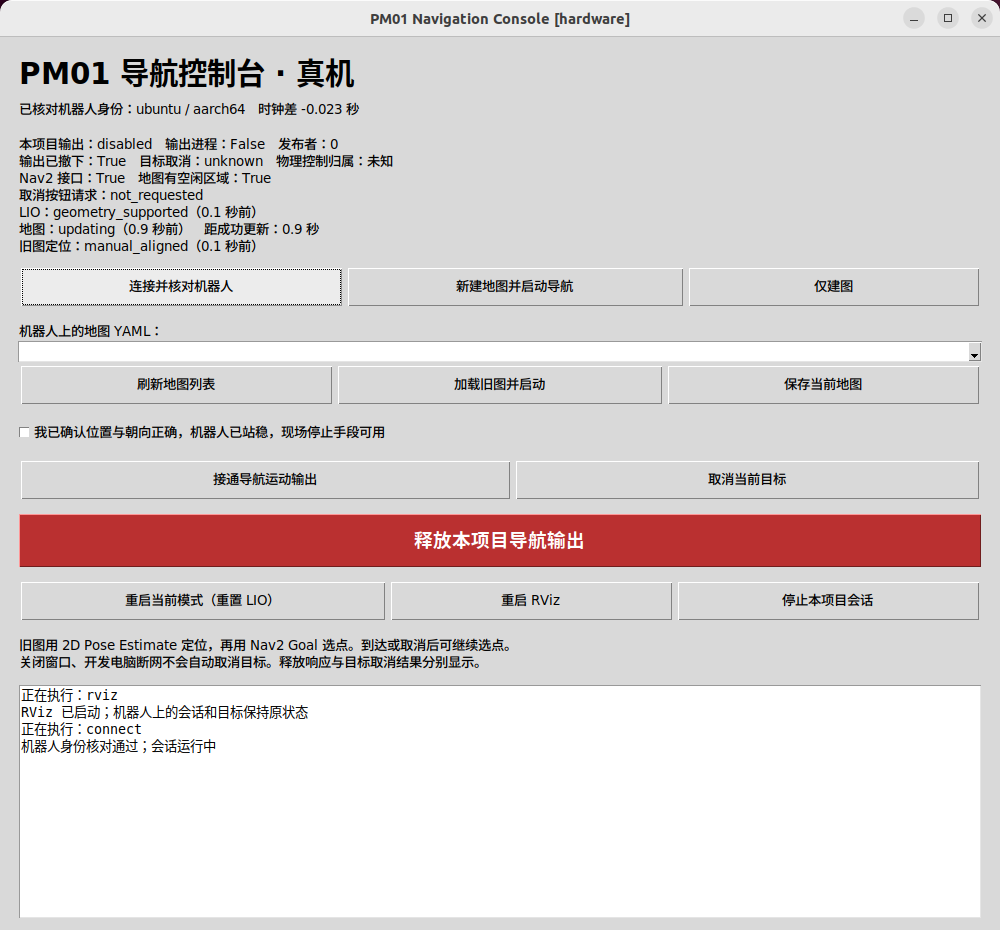

# PM01 Navigation Tutorial

[简体中文](tutorial.md) | English

For an overview of how the system works, see [PM01 navigation principles (Feishu, Chinese)](https://dx3a2bminsq.feishu.cn/wiki/EQIzwTD5Hibfl5kNQW5cmdcDnIb?from=from_copylink).

Both workflows use Ubuntu 22.04 and ROS 2 Humble. Simulation needs an x86_64 computer with desktop OpenGL. An NVIDIA GPU is recommended. Hardware uses a native Ubuntu development computer and the PM01 ARM64 onboard computer.

## Get the source

Run on the development computer. The steps below use `~/engineai_tutorials/engineai_fastlio_navigation` as the workspace.

```bash
sudo apt-get update
sudo apt-get install -y git openssh-client rsync nano
cd ~
git clone https://github.com/engineai-robotics/engineai_tutorials.git
cd engineai_tutorials/engineai_fastlio_navigation
```

## Simulation

### 1. Install and build

Run on the simulation computer. Installation needs sudo. The first build downloads the simulation assets and Livox SDK.

```bash
cd ~/engineai_tutorials/engineai_fastlio_navigation
bash scripts/install_dependencies.sh sim
bash scripts/build.sh sim
```

### 2. Start the simulation

Start navigation on a new map. Gazebo and RViz open automatically. Wait for the robot to stand and for RViz to display the map and robot arrow. Motion output starts disabled.

```bash
cd ~/engineai_tutorials/engineai_fastlio_navigation
source scripts/env.sh
ros2 launch pm01_navigation_bringup navigation.launch.py profile:=sim mode:=fresh
```

If a package is missing, source the environment from this workspace and check the package paths. Both should point into this workspace's `install/`. If the map stays empty, check the startup log for the standing state, point clouds, and TF.

```bash
source scripts/env.sh
ros2 pkg prefix pm01_navigation_bringup
ros2 pkg prefix slam_toolbox
```

For mapping only, use `mapping`. End the current simulation before switching modes.

```bash
cd ~/engineai_tutorials/engineai_fastlio_navigation
source scripts/env.sh
ros2 launch pm01_navigation_bringup navigation.launch.py profile:=sim mode:=mapping
```

Once the map appears, open another terminal on the simulation computer. Enable output and start the keyboard window. Focus the window, then use **W/S** for forward and reverse, **A/D** to turn, and **Space** to stop. Releasing a key, losing focus, or closing the window stops the corresponding velocity input. The defaults are 0.40 m/s and 0.70 rad/s. Adjust them with `--linear-speed` and `--angular-speed`.

```bash
cd ~/engineai_tutorials/engineai_fastlio_navigation
source scripts/env.sh
ros2 run pm01_navigation_client pm01_nav enable-motion
ros2 run pm01_navigation_client pm01_sim_keyboard
```



When mapping is complete, press Space and close the keyboard window. Save the map and end the session. Keep the keyboard window closed during automatic navigation.

### 3. Send a goal

In `fresh` or `saved` mode, check the map and robot pose. Open another simulation terminal and enable motion output.

```bash
cd ~/engineai_tutorials/engineai_fastlio_navigation
source scripts/env.sh
ros2 run pm01_navigation_client pm01_nav enable-motion
```

After output is enabled, choose **Nav2 Goal** in RViz. Hold the left mouse button in white free space and drag to set the heading. You can also send a goal from the terminal. Replace the sample with your target in the map frame. The arguments are `x y yaw` in meters, meters, and radians. Arrival returns `succeeded`.



```bash
cd ~/engineai_tutorials/engineai_fastlio_navigation
source scripts/env.sh
ros2 run pm01_navigation_client pm01_nav goal 0.75 0.0 0.0
```

While the backend is running, you can reopen RViz from another simulation terminal.

```bash
cd ~/engineai_tutorials/engineai_fastlio_navigation
source scripts/env.sh
ros2 run rviz2 rviz2 -d "$(ros2 pkg prefix pm01_navigation_bringup)/share/pm01_navigation_bringup/config/sim/navigation_sim.rviz" --ros-args -p use_sim_time:=true
```

### 4. Save the map and finish

Keep the backend running and save the map on the simulation computer. After `success=True`, record the `map.yaml` path in `message`. Keep the entire output directory when backing up a map.

```bash
cd ~/engineai_tutorials/engineai_fastlio_navigation
source scripts/env.sh
ros2 run pm01_navigation_client pm01_nav save-map
```

To interrupt a goal, run `cancel` and check the final cancellation result.

```bash
cd ~/engineai_tutorials/engineai_fastlio_navigation
source scripts/env.sh
ros2 run pm01_navigation_client pm01_nav cancel
```

To finish, release output and check status. Confirm `output_process_running: false`, `output_publishers: 0`, and `output_detached: true`, then press **Ctrl+C** in the simulation launch terminal.

```bash
cd ~/engineai_tutorials/engineai_fastlio_navigation
source scripts/env.sh
ros2 run pm01_navigation_client pm01_nav release-motion
ros2 run pm01_navigation_client pm01_nav status
```

### 5. Load a saved map

End the previous session, then start `saved` on the simulation computer. Replace the YAML path with the path to your saved map.

```bash
cd ~/engineai_tutorials/engineai_fastlio_navigation
source scripts/env.sh
ros2 launch pm01_navigation_bringup navigation.launch.py \
  profile:=sim mode:=saved map:=/absolute/path/to/map.yaml
```

In RViz select **2D Pose Estimate**. Use the Gazebo scene as a reference and drag from the robot's actual position in the direction it is facing. Set the initial pose after each LIO restart. Check the map and pose alignment before enabling output and sending a goal.



## Hardware

### 1. Prepare the robot

Connect the development computer to the robot network. The robot's built-in network commonly uses `192.168.0.162`. Use the actual address at your site.

Run the setup wizard on the development computer. Enter the robot address, verify the host fingerprint, and follow the SSH and sudo prompts.

```bash
cd ~/engineai_tutorials/engineai_fastlio_navigation
bash scripts/setup_hardware.sh
```

Choose the **Aliyun image** or the **GitHub deployment bundle**. The development computer downloads the image, and the wizard transfers and loads it on the robot. Switch sources with `--download-source aliyun` or `--download-source github`.

Check the robot, image, and bidirectional communication reported by the wizard. If it reports a clock offset, confirm synchronization when appropriate for the site. After setup, load the environment on the development computer. Run the same `source` command in each new development terminal.

```bash
source ~/.config/pm01_navigation/active.env
printf '%s\n' "$PM01_ROBOT_SSH" "$PM01_DEPLOYMENT_CONFIG"
```

To switch robots or networks, end the affected session, run the wizard again, and reload the environment. Start the navigation backend using the steps below.

### 2. Choose a mode



| Mode | Use |
| --- | --- |
| `fresh` | Build a map from the current position and navigate |
| `mapping` | Collect a map with the physical controller |
| `saved` | Load a saved map and navigate |

Let the robot stand steadily and remain still for LIO initialization. Motion output starts disabled. Run one mode at a time and end the current session before switching. Connect from the development computer. Run the `session` commands in this **robot SSH terminal**.

```bash
source ~/.config/pm01_navigation/active.env
ssh "$PM01_ROBOT_SSH"
```

#### `fresh` new map navigation

Start in the robot SSH terminal and wait for the session ID.

```bash
python3 ~/pm01_navigation_deploy/pm01_container.py session start --mode fresh
```

Open RViz in a new **development computer terminal**. Check the map, obstacles, and robot pose against the scene. If the map stays empty, run `python3 ~/pm01_navigation_deploy/pm01_container.py session status` in the robot SSH terminal and follow the log path it reports.

```bash
cd ~/engineai_tutorials/engineai_fastlio_navigation
source ~/.config/pm01_navigation/active.env
ros2 run rviz2 rviz2 -d "$(ros2 pkg prefix pm01_navigation_bringup)/share/pm01_navigation_bringup/config/hardware/navigation.rviz" --ros-args -p use_sim_time:=false
```

On first use you can check path planning from another development terminal. Choose a free position on the map. RViz displays the path when planning succeeds.

```bash
source ~/.config/pm01_navigation/active.env
ros2 run pm01_navigation_client pm01_nav --timeout 20 plan 1.0 0.0 0.0
```





Check that the robot is steady, the area is clear, and an operator has the stop control. If a goal is already active, cancel it and confirm the result. Enable output in another development terminal.

```bash
cd ~/engineai_tutorials/engineai_fastlio_navigation
source ~/.config/pm01_navigation/active.env
ros2 run pm01_navigation_client pm01_nav enable-motion
```

After `success=True`, choose **Nav2 Goal** in RViz and drag to set the heading, or send a map-frame goal from the development computer.

```bash
cd ~/engineai_tutorials/engineai_fastlio_navigation
source ~/.config/pm01_navigation/active.env
ros2 run pm01_navigation_client pm01_nav goal 0.75 0.0 0.0
```

After the CLI returns `succeeded`, send the next goal as needed. To interrupt a goal, cancel it on the development computer and confirm the result.

```bash
cd ~/engineai_tutorials/engineai_fastlio_navigation
source ~/.config/pm01_navigation/active.env
ros2 run pm01_navigation_client pm01_nav cancel
```

#### `mapping` mapping only

Start mapping in the robot SSH terminal. Keep project motion output disabled and use the physical controller to collect the map.

```bash
python3 ~/pm01_navigation_deploy/pm01_container.py session start --mode mapping
```

Open RViz on the development computer. Check that the map and pose update as you drive. Stop the robot and save the map when finished.

```bash
cd ~/engineai_tutorials/engineai_fastlio_navigation
source ~/.config/pm01_navigation/active.env
ros2 run rviz2 rviz2 -d "$(ros2 pkg prefix pm01_navigation_bringup)/share/pm01_navigation_bringup/config/hardware/navigation.rviz" --ros-args -p use_sim_time:=false
```

#### `saved` saved map navigation

List saved maps in the robot SSH terminal.

```bash
python3 ~/pm01_navigation_deploy/pm01_container.py session maps
```

End the previous session and let the robot stand steadily. Start saved-map navigation in the same SSH terminal. Replace the sample with the full `map.yaml` path on the robot.

```bash
python3 ~/pm01_navigation_deploy/pm01_container.py session start \
  --mode saved --map /absolute/path/to/map.yaml
```

Open RViz on the development computer or reuse its existing window.

```bash
cd ~/engineai_tutorials/engineai_fastlio_navigation
source ~/.config/pm01_navigation/active.env
ros2 run rviz2 rviz2 -d "$(ros2 pkg prefix pm01_navigation_bringup)/share/pm01_navigation_bringup/config/hardware/navigation.rviz" --ros-args -p use_sim_time:=false
```

Keep output disabled. Select **2D Pose Estimate** in RViz and drag from the robot's actual position in the direction it is facing. Check live observations against the walls and the robot arrow against the scene before enabling output. Set the initial pose after each LIO restart. If alignment is lost, cancel the goal and release output before setting the pose again.



Check that the robot is steady and the operator has the stop control. If a goal is already active, cancel it and confirm the result. Enable output from the development computer.

```bash
cd ~/engineai_tutorials/engineai_fastlio_navigation
source ~/.config/pm01_navigation/active.env
ros2 run pm01_navigation_client pm01_nav enable-motion
```

After `success=True`, send a goal with **Nav2 Goal** or the following command.

```bash
cd ~/engineai_tutorials/engineai_fastlio_navigation
source ~/.config/pm01_navigation/active.env
ros2 run pm01_navigation_client pm01_nav goal 0.75 0.0 0.0
```

To interrupt a goal, cancel it from the development computer and confirm the result.

```bash
cd ~/engineai_tutorials/engineai_fastlio_navigation
source ~/.config/pm01_navigation/active.env
ros2 run pm01_navigation_client pm01_nav cancel
```

If the enable service is unavailable, source `active.env` for the selected device and check `session status` on the robot. Once the backend is running, check the ROS domain, peer addresses, and clocks on both computers.

### 3. Save the map and end the session

Before stopping the backend, save any map you want to keep from the development computer. After `success=True`, record the path in `message`. The files are on the **robot**. Keep the whole directory when copying or backing up a map.

```bash
cd ~/engineai_tutorials/engineai_fastlio_navigation
source ~/.config/pm01_navigation/active.env
ros2 run pm01_navigation_client pm01_nav save-map
```

Release output and check status on the development computer. Confirm `output_process_running: false`, `output_publishers: 0`, and `output_detached: true`, then check that the robot has stopped.

```bash
cd ~/engineai_tutorials/engineai_fastlio_navigation
source ~/.config/pm01_navigation/active.env
ros2 run pm01_navigation_client pm01_nav release-motion
ros2 run pm01_navigation_client pm01_nav status
```

Stop the session in the robot SSH terminal. Use the same command after mapping only.

```bash
python3 ~/pm01_navigation_deploy/pm01_container.py session stop
```

### Optional console

After running the setup wizard, start the console on the development computer. Check the robot identity and session before starting, saving a map, or releasing output. Send goals with RViz or the CLI.

```bash
source ~/.config/pm01_navigation/active.env
ros2 run pm01_navigation_console pm01_console --config "$PM01_CONSOLE_CONFIG"
```



## Update an existing installation

Check the current branch and local changes on the development computer. Commit or back up your changes before pulling.

```bash
cd ~/engineai_tutorials/engineai_fastlio_navigation
git status --short
git branch --show-current
git pull --ff-only
git rev-parse HEAD
```

Rebuild on the simulation computer and load its environment.

```bash
cd ~/engineai_tutorials/engineai_fastlio_navigation
bash scripts/build.sh sim
source scripts/env.sh
```

For a development computer connected to hardware, build `desktop` to update the client and configuration, then load its environment.

```bash
cd ~/engineai_tutorials/engineai_fastlio_navigation
bash scripts/build.sh desktop
source ~/.config/pm01_navigation/active.env
```

To update the robot image, stop the current robot session and rerun the wizard on the development computer. Confirm the image selection and load the environment after setup succeeds.

```bash
cd ~/engineai_tutorials/engineai_fastlio_navigation
bash scripts/setup_hardware.sh
source ~/.config/pm01_navigation/active.env
```

## Common settings

**Robot networking.** On the development computer, edit `deployment.yaml` at `$PM01_DEPLOYMENT_CONFIG` and apply it. Reload `active.env` and reopen the clients. Rerun the wizard when changing the robot address or SSH alias.

```bash
cd ~/engineai_tutorials/engineai_fastlio_navigation
source ~/.config/pm01_navigation/active.env
python3 scripts/configure_hardware.py apply --config "$PM01_DEPLOYMENT_CONFIG"
```

**Clock offset.** If the map stops updating or TF reports time errors, compare the clocks from the development computer. Follow the wizard's synchronization prompt when a correction is needed.

```bash
cd ~/engineai_tutorials/engineai_fastlio_navigation
source ~/.config/pm01_navigation/active.env
ros2 run pm01_navigation_client pm01_clock_check \
  --config "$PM01_DEPLOYMENT_CONFIG" --max-skew 0.10
```

**Simulation graphics and parallel instances.** On dual-GPU computers, add `render_backend:=nvidia` to the simulation launch command to select the NVIDIA GPU. For parallel simulations, give each instance a separate ROS domain and Gazebo port, and load the same settings in all terminals for that instance.

```bash
cd ~/engineai_tutorials/engineai_fastlio_navigation
export PM01_DOMAIN_ID=185
export PM01_GAZEBO_MASTER_URI=http://127.0.0.1:11379
source scripts/env.sh
```

**Maps and RViz views.** The default map directory is `~/.local/share/pm01_navigation/maps/` on the computer running the backend. Set `save_root` in simulation. On the robot, set `map_root` in `~/.config/pm01_navigation/docker/session.json` to a mounted user data directory. Save personal RViz views on the computer running RViz and open them with `-d`.

See [Configuration and interfaces](development.en.md) for parameter overrides and application APIs.
