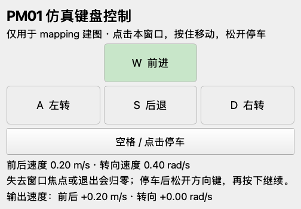
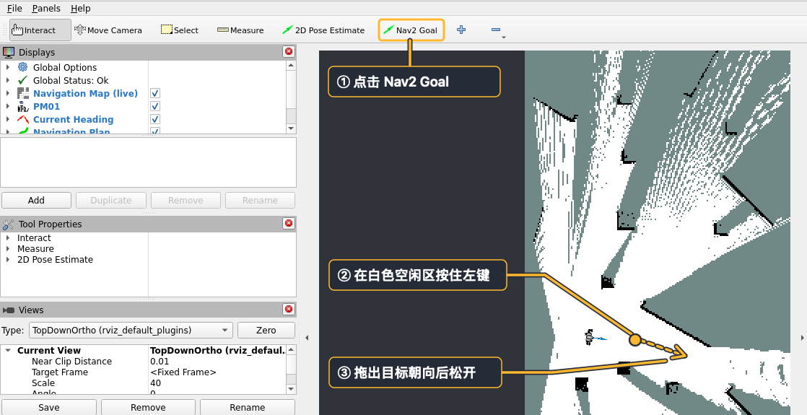
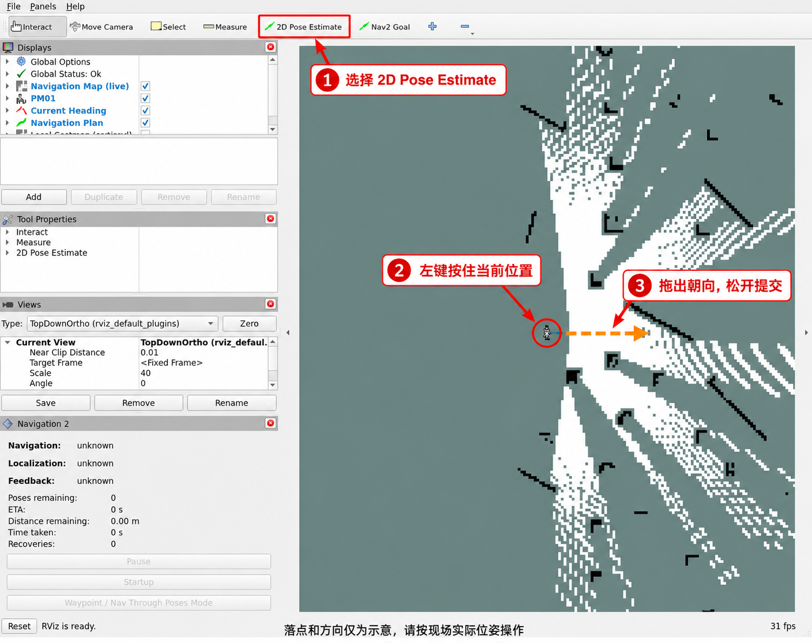
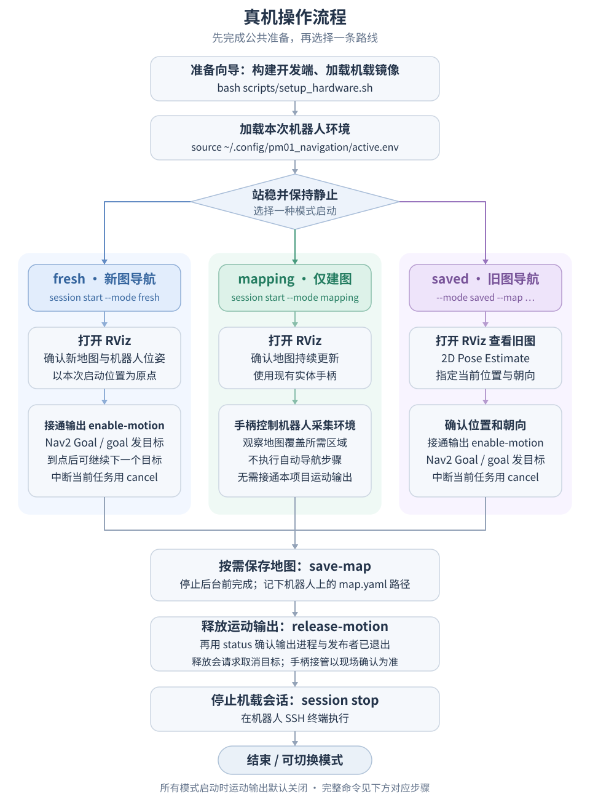
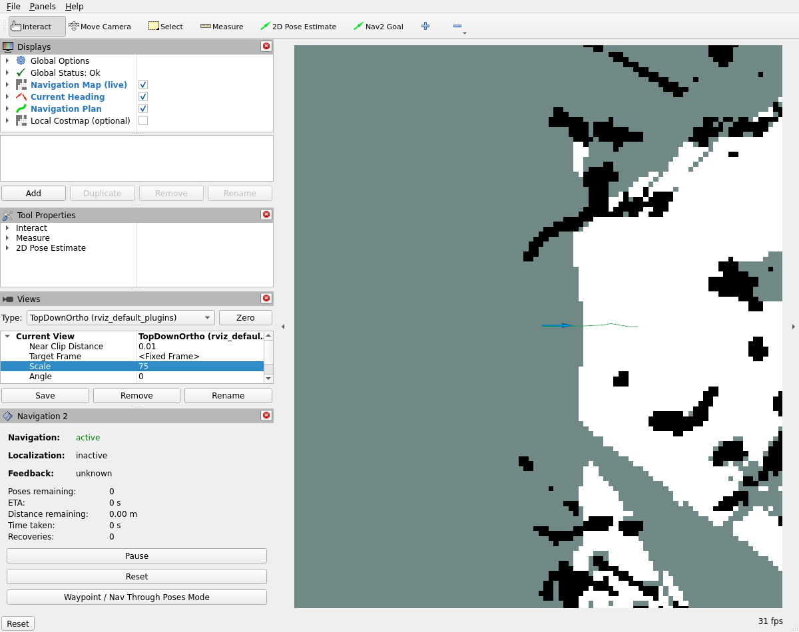
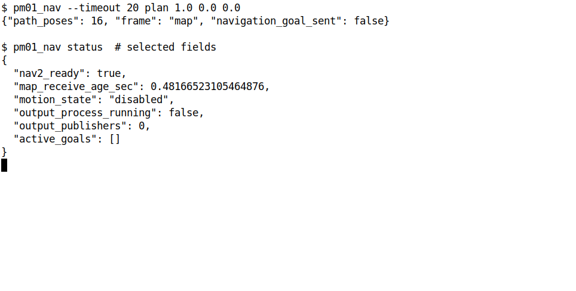
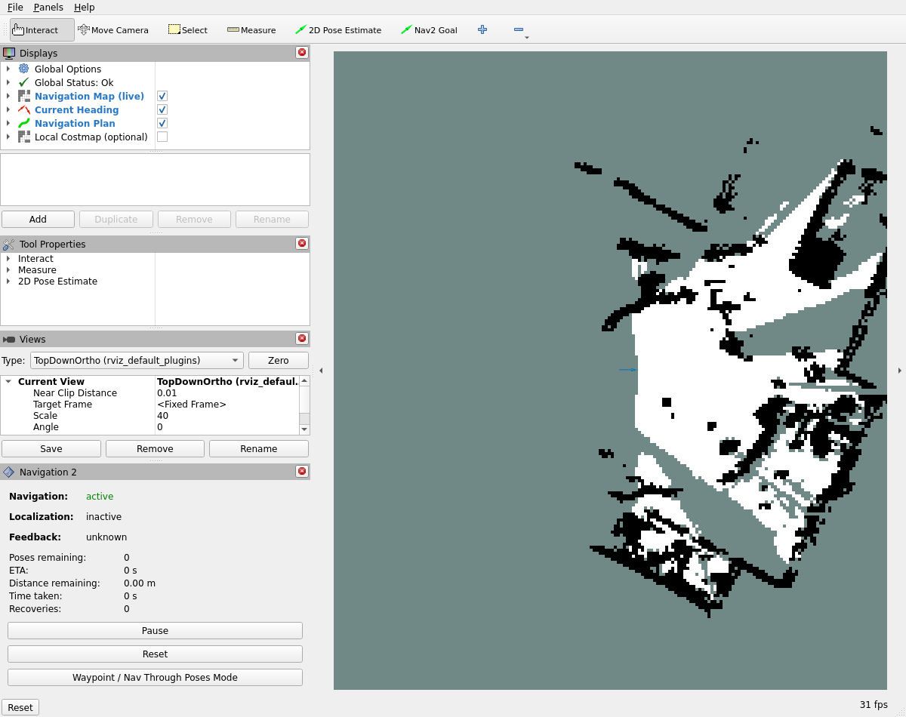
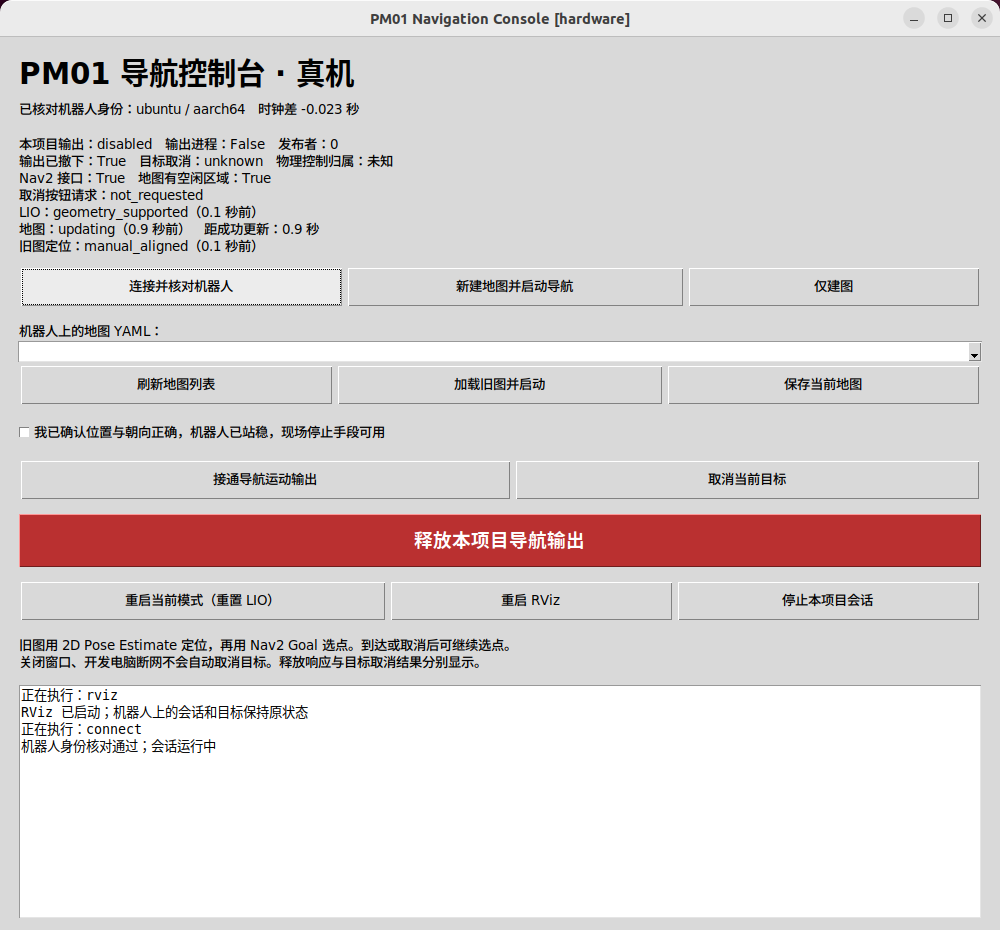

# PM01 导航实操教程

简体中文 | [English](tutorial.en.md)

了解项目原理可阅读 [PM01 导航原理（飞书）](https://dx3a2bminsq.feishu.cn/wiki/EQIzwTD5Hibfl5kNQW5cmdcDnIb?from=from_copylink)。

两条路线均使用 Ubuntu 22.04 和 ROS 2 Humble。仿真需要支持 OpenGL 的 x86_64 开发电脑，推荐 NVIDIA GPU。真机使用原生 Ubuntu 开发电脑和 PM01 ARM64 机载电脑。

## 获取源码

在开发电脑执行。后续命令以 `~/engineai_tutorials/engineai_fastlio_navigation` 为工作目录。

```bash
sudo apt-get update
sudo apt-get install -y git openssh-client rsync nano
cd ~
git clone https://github.com/engineai-robotics/engineai_tutorials.git
cd engineai_tutorials/engineai_fastlio_navigation
```

## 仿真

### 1. 安装和构建

在仿真电脑执行。安装依赖需要 sudo，首次构建会联网获取仿真资源和 Livox SDK。

```bash
cd ~/engineai_tutorials/engineai_fastlio_navigation
bash scripts/install_dependencies.sh sim
bash scripts/build.sh sim
```

### 2. 启动

在仿真电脑启动新图导航。Gazebo 和 RViz 打开后，等机器人站稳，确认 RViz 显示地图和机器人箭头。运动输出默认关闭。

```bash
cd ~/engineai_tutorials/engineai_fastlio_navigation
source scripts/env.sh
ros2 launch pm01_navigation_bringup navigation.launch.py profile:=sim mode:=fresh
```

若找不到包，在当前仓库加载环境并查询安装路径。两个包都应指向本次构建的 `install/`。地图长时间为空时，查看启动日志，确认机器人已站稳、点云和 TF 已收到。

```bash
source scripts/env.sh
ros2 pkg prefix pm01_navigation_bringup
ros2 pkg prefix slam_toolbox
```

只采集地图时，使用下面的 `mapping` 启动命令。切换模式前先结束当前仿真。

```bash
cd ~/engineai_tutorials/engineai_fastlio_navigation
source scripts/env.sh
ros2 launch pm01_navigation_bringup navigation.launch.py profile:=sim mode:=mapping
```

地图出现后，在仿真电脑的另一个终端接通输出并打开键盘控制。点击键盘窗口，用 **W/S** 前后走、**A/D** 转向、**空格**停止。松开方向键、离开窗口或关闭窗口时，该窗口会停止对应的速度输入。默认前后速度为 0.40 m/s，转向速度为 0.70 rad/s，可用 `--linear-speed` 和 `--angular-speed` 调整。

```bash
cd ~/engineai_tutorials/engineai_fastlio_navigation
source scripts/env.sh
ros2 run pm01_navigation_client pm01_nav enable-motion
ros2 run pm01_navigation_client pm01_sim_keyboard
```



采集结束后按空格停车，关闭键盘窗口，再保存地图和结束会话。进入自动导航前保持键盘窗口关闭。

### 3. 发送目标

在 `fresh` 或 `saved` 会话中确认地图和位姿后，另开仿真终端接通运动输出。

```bash
cd ~/engineai_tutorials/engineai_fastlio_navigation
source scripts/env.sh
ros2 run pm01_navigation_client pm01_nav enable-motion
```

接通成功后，在 RViz 选择 **Nav2 Goal**，在白色空闲区按住左键并拖出目标朝向。也可以从终端发送目标。把示例坐标换成现场目标，参数依次为地图坐标 `x y yaw`，单位为米、米、弧度。到达后返回 `succeeded`。



```bash
cd ~/engineai_tutorials/engineai_fastlio_navigation
source scripts/env.sh
ros2 run pm01_navigation_client pm01_nav goal 0.75 0.0 0.0
```

后台继续运行时，可在另一个仿真终端重新打开 RViz。

```bash
cd ~/engineai_tutorials/engineai_fastlio_navigation
source scripts/env.sh
ros2 run rviz2 rviz2 -d "$(ros2 pkg prefix pm01_navigation_bringup)/share/pm01_navigation_bringup/config/sim/navigation_sim.rviz" --ros-args -p use_sim_time:=true
```

### 4. 存图和结束

保持后台运行，在仿真电脑保存地图。`success=True` 后记录 `message` 中的 `map.yaml` 路径，备份时保留整个存图目录。

```bash
cd ~/engineai_tutorials/engineai_fastlio_navigation
source scripts/env.sh
ros2 run pm01_navigation_client pm01_nav save-map
```

需要中断目标时执行 `cancel`，并确认最终取消结果。

```bash
cd ~/engineai_tutorials/engineai_fastlio_navigation
source scripts/env.sh
ros2 run pm01_navigation_client pm01_nav cancel
```

结束时释放运动输出并查询状态。确认 `output_process_running: false`、`output_publishers: 0` 和 `output_detached: true` 后，在仿真启动终端按 **Ctrl+C**。

```bash
cd ~/engineai_tutorials/engineai_fastlio_navigation
source scripts/env.sh
ros2 run pm01_navigation_client pm01_nav release-motion
ros2 run pm01_navigation_client pm01_nav status
```

### 5. 加载旧图

结束上一会话后，在仿真电脑启动 `saved`，替换为本机保存的 YAML 路径。

```bash
cd ~/engineai_tutorials/engineai_fastlio_navigation
source scripts/env.sh
ros2 launch pm01_navigation_bringup navigation.launch.py \
  profile:=sim mode:=saved map:=/absolute/path/to/map.yaml
```

在 RViz 选 **2D Pose Estimate**，对照 Gazebo，在地图上从机器人实际位置拖出实际朝向。每次重启 LIO 后重新设置初始位姿。确认地图和位姿对齐后，接通运动输出再发目标。



## 真机

### 1. 准备设备

在开发电脑接入机器人网络。机器人自带网络的常见地址是 `192.168.0.162`，使用现场实际地址。

在开发电脑运行向导，输入机器人地址，核对主机指纹并按提示完成 SSH 登录和 sudo 授权。

```bash
cd ~/engineai_tutorials/engineai_fastlio_navigation
bash scripts/setup_hardware.sh
```

选择**阿里云镜像**或 **GitHub 部署包**。开发电脑负责下载，向导将镜像传入机器人并加载。可通过 `--download-source aliyun` 或 `--download-source github` 切换来源。

核对向导输出的机器人、镜像和双向通信结果。出现时差提醒时，按现场情况确认是否校时。完成后，在开发电脑加载环境。后续每个开发电脑终端都先执行同一条 `source`。

```bash
source ~/.config/pm01_navigation/active.env
printf '%s\n' "$PM01_ROBOT_SSH" "$PM01_DEPLOYMENT_CONFIG"
```

换机器人或网络时，先结束需要重新配置的会话，再运行向导并重新加载环境。向导完成后，按下面的步骤启动导航后台。

### 2. 选择运行模式



| 模式 | 用途 |
| --- | --- |
| `fresh` | 从当前位置建图并导航 |
| `mapping` | 使用实体手柄采集地图 |
| `saved` | 加载已有地图并导航 |

启动前让机器人站稳并保持静止，供 LIO 初始化。运动输出默认关闭。每次运行一种模式，切换前先结束上一会话。用开发电脑登录机器人，后续 `session` 命令在这个 **SSH 终端**执行。

```bash
source ~/.config/pm01_navigation/active.env
ssh "$PM01_ROBOT_SSH"
```

#### `fresh` 新图导航

在机器人 SSH 终端启动，等待会话 ID。

```bash
python3 ~/pm01_navigation_deploy/pm01_container.py session start --mode fresh
```

另开**开发电脑终端**打开 RViz，确认地图、障碍与机器人位姿符合现场。地图未出现时，在机器人 SSH 终端运行 `python3 ~/pm01_navigation_deploy/pm01_container.py session status`，按返回的日志路径查看启动状态。

```bash
cd ~/engineai_tutorials/engineai_fastlio_navigation
source ~/.config/pm01_navigation/active.env
ros2 run rviz2 rviz2 -d "$(ros2 pkg prefix pm01_navigation_bringup)/share/pm01_navigation_bringup/config/hardware/navigation.rviz" --ros-args -p use_sim_time:=false
```

首次接入可在开发电脑另开终端检查规划路径。将坐标换成地图上的空闲位置，成功时 RViz 显示路径。

```bash
source ~/.config/pm01_navigation/active.env
ros2 run pm01_navigation_client pm01_nav --timeout 20 plan 1.0 0.0 0.0
```





确认机器人站稳、场地空旷，现场人员持有停止控制。若已有待执行目标，先取消并确认结果。在另一个开发电脑终端接通运动输出。

```bash
cd ~/engineai_tutorials/engineai_fastlio_navigation
source ~/.config/pm01_navigation/active.env
ros2 run pm01_navigation_client pm01_nav enable-motion
```

接通返回 `success=True` 后，在 RViz 用 **Nav2 Goal** 选点并拖出朝向，或在开发电脑发送地图坐标目标。

```bash
cd ~/engineai_tutorials/engineai_fastlio_navigation
source ~/.config/pm01_navigation/active.env
ros2 run pm01_navigation_client pm01_nav goal 0.75 0.0 0.0
```

CLI 返回 `succeeded` 后可继续发下一目标。需要中断时，在开发电脑取消目标并确认结果。

```bash
cd ~/engineai_tutorials/engineai_fastlio_navigation
source ~/.config/pm01_navigation/active.env
ros2 run pm01_navigation_client pm01_nav cancel
```

#### `mapping` 仅建图

在机器人 SSH 终端启动建图。保持本项目运动输出关闭，使用实体手柄采集。

```bash
python3 ~/pm01_navigation_deploy/pm01_container.py session start --mode mapping
```

在开发电脑打开 RViz，确认地图和位姿随手柄操作更新。采集完成后停车并存图。

```bash
cd ~/engineai_tutorials/engineai_fastlio_navigation
source ~/.config/pm01_navigation/active.env
ros2 run rviz2 rviz2 -d "$(ros2 pkg prefix pm01_navigation_bringup)/share/pm01_navigation_bringup/config/hardware/navigation.rviz" --ros-args -p use_sim_time:=false
```

#### `saved` 旧图导航

在机器人 SSH 终端查看已保存的地图。

```bash
python3 ~/pm01_navigation_deploy/pm01_container.py session maps
```

结束上一会话并让机器人站稳。仍在 SSH 终端启动旧图导航，将示例路径替换为机器人上的 `map.yaml` 完整路径。

```bash
python3 ~/pm01_navigation_deploy/pm01_container.py session start \
  --mode saved --map /absolute/path/to/map.yaml
```

在开发电脑打开 RViz，或复用已打开的窗口。

```bash
cd ~/engineai_tutorials/engineai_fastlio_navigation
source ~/.config/pm01_navigation/active.env
ros2 run rviz2 rviz2 -d "$(ros2 pkg prefix pm01_navigation_bringup)/share/pm01_navigation_bringup/config/hardware/navigation.rviz" --ros-args -p use_sim_time:=false
```

保持输出关闭。在 RViz 选 **2D Pose Estimate**，在地图上从机器人实际位置拖出实际朝向。等实时观测与墙面、机器人箭头与现场位置对齐，再接通输出。每次重启 LIO 后重新设置初始位姿。发现对齐偏差时，先取消目标和释放输出，再重新设置位姿。



确认机器人站稳，现场人员持有停止控制。若已有待执行目标，先取消并确认结果。在开发电脑接通输出。

```bash
cd ~/engineai_tutorials/engineai_fastlio_navigation
source ~/.config/pm01_navigation/active.env
ros2 run pm01_navigation_client pm01_nav enable-motion
```

接通返回 `success=True` 后，使用 **Nav2 Goal** 或以下命令发目标。

```bash
cd ~/engineai_tutorials/engineai_fastlio_navigation
source ~/.config/pm01_navigation/active.env
ros2 run pm01_navigation_client pm01_nav goal 0.75 0.0 0.0
```

需要中断时，在开发电脑取消目标并确认结果。

```bash
cd ~/engineai_tutorials/engineai_fastlio_navigation
source ~/.config/pm01_navigation/active.env
ros2 run pm01_navigation_client pm01_nav cancel
```

若接通命令提示服务不可用，先加载当前设备的 `active.env`，再查机载 `session status`。后台已启动时，核对两端 ROS 域、通信地址和系统时间。

### 3. 保存地图并结束会话

在关闭后台前，从开发电脑保存需要保留的地图。`success=True` 后记录 `message` 中的路径。地图文件在**机器人**上，复制或备份时保留整个目录。

```bash
cd ~/engineai_tutorials/engineai_fastlio_navigation
source ~/.config/pm01_navigation/active.env
ros2 run pm01_navigation_client pm01_nav save-map
```

在开发电脑释放输出并核对状态。确认 `output_process_running: false`、`output_publishers: 0` 和 `output_detached: true`，并在现场确认机器人已停稳。

```bash
cd ~/engineai_tutorials/engineai_fastlio_navigation
source ~/.config/pm01_navigation/active.env
ros2 run pm01_navigation_client pm01_nav release-motion
ros2 run pm01_navigation_client pm01_nav status
```

在机器人 SSH 终端停止会话。仅建图模式也使用这个停止命令。

```bash
python3 ~/pm01_navigation_deploy/pm01_container.py session stop
```

### 可选控制台

完成准备向导后，在开发电脑启动控制台。核对界面中的机器人身份与会话，再选择启动、保存地图或释放输出。通过 RViz 或 CLI 发送导航目标。

```bash
source ~/.config/pm01_navigation/active.env
ros2 run pm01_navigation_console pm01_console --config "$PM01_CONSOLE_CONFIG"
```



## 更新已有环境

在开发电脑查看本地改动和当前分支。先提交或备份自己的改动，再拉取更新。

```bash
cd ~/engineai_tutorials/engineai_fastlio_navigation
git status --short
git branch --show-current
git pull --ff-only
git rev-parse HEAD
```

在仿真电脑重新构建并加载环境。

```bash
cd ~/engineai_tutorials/engineai_fastlio_navigation
bash scripts/build.sh sim
source scripts/env.sh
```

真机开发电脑只更新客户端和配置时，构建 `desktop` 并加载环境。

```bash
cd ~/engineai_tutorials/engineai_fastlio_navigation
bash scripts/build.sh desktop
source ~/.config/pm01_navigation/active.env
```

需要更新机器人镜像时，先停止当前真机会话，再在开发电脑重跑向导。确认镜像选择，准备成功后加载环境。

```bash
cd ~/engineai_tutorials/engineai_fastlio_navigation
bash scripts/setup_hardware.sh
source ~/.config/pm01_navigation/active.env
```

## 常用设置

**真机通信。** 在开发电脑修改 `$PM01_DEPLOYMENT_CONFIG` 指向的 `deployment.yaml` 后应用配置，再加载 `active.env` 并重开客户端。更换地址或 SSH 别名时优先重跑向导。

```bash
cd ~/engineai_tutorials/engineai_fastlio_navigation
source ~/.config/pm01_navigation/active.env
python3 scripts/configure_hardware.py apply --config "$PM01_DEPLOYMENT_CONFIG"
```

**时差。** 若地图停更或 TF 时间异常，在开发电脑比较两机时间。需要调整时按向导的校时提示操作。

```bash
cd ~/engineai_tutorials/engineai_fastlio_navigation
source ~/.config/pm01_navigation/active.env
ros2 run pm01_navigation_client pm01_clock_check \
  --config "$PM01_DEPLOYMENT_CONFIG" --max-skew 0.10
```

**仿真显卡与并行实例。** 双显卡电脑可在仿真启动命令末尾加 `render_backend:=nvidia`。并行运行时，每个实例使用独立的 ROS 域和 Gazebo 端口，该实例的所有终端都加载同一组设置。

```bash
cd ~/engineai_tutorials/engineai_fastlio_navigation
export PM01_DOMAIN_ID=185
export PM01_GAZEBO_MASTER_URI=http://127.0.0.1:11379
source scripts/env.sh
```

**地图与视图。** 默认地图目录为运行后台的电脑上的 `~/.local/share/pm01_navigation/maps/`。仿真通过 `save_root` 修改存图位置，真机通过机器人 `~/.config/pm01_navigation/docker/session.json` 的 `map_root` 选择已挂载的用户数据路径。个人 RViz 视图保存在运行 RViz 的电脑上，打开时指定 `-d` 路径。

参数覆盖与应用接口见[配置与接口](development.md)。
